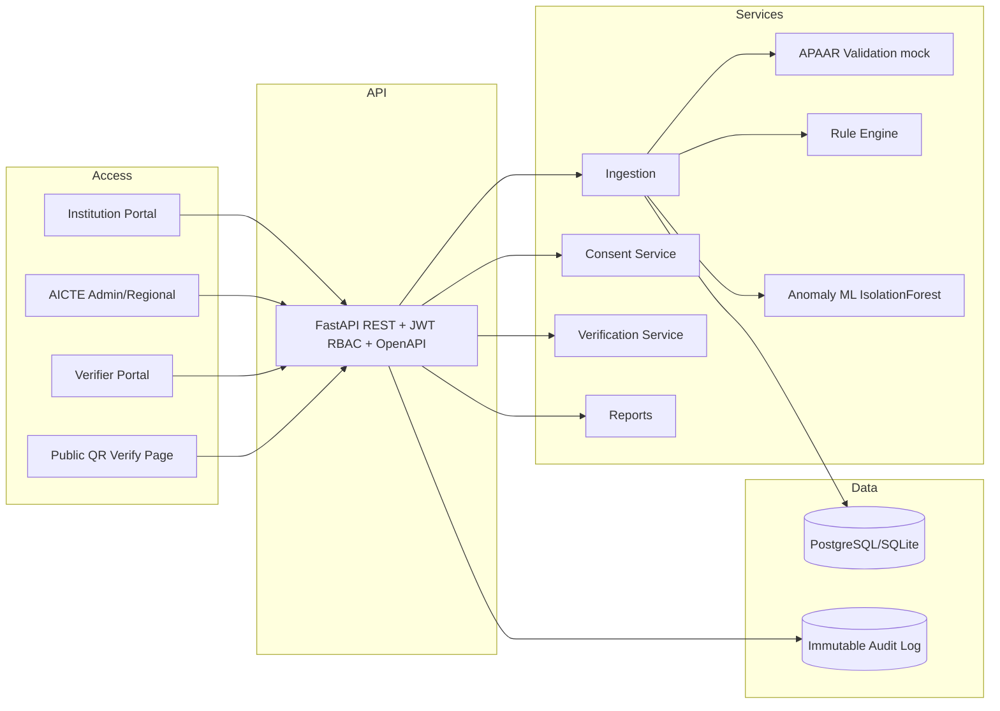

# AICTE-SETU — APAAR-based Student Data Management & Verification System

A hackathon prototype demonstrating student-level data submission by institutions, keyed by APAAR ID, with automated validation, anomaly detection, real-time dashboards, consent-based verification, and tamper-evident records.

## Architecture



## Tech stack
- Backend: FastAPI (Python), SQLAlchemy, scikit-learn, JWT (python-jose), bcrypt
- Frontend: React + TypeScript + Vite + Tailwind + Recharts
- DB: SQLite (demo) / PostgreSQL (prod)
- Auth: JWT + role-based access + mock OTP/MFA

## Run locally

Backend (port 8000):
```
cd backend
pip install -r requirements.txt
python -m app.seed
uvicorn app.main:app --reload --port 8000
```
Swagger docs: http://localhost:8000/docs

Frontend (port 5173):
```
cd frontend
npm install
npm run dev
```
Open http://localhost:5173

## Demo credentials (password + OTP 123456)
| Role | Email | Password |
|---|---|---|
| AICTE Admin | admin@aicte.gov.in | admin123 |
| Regional Officer (Maharashtra) | regional@aicte.gov.in | regional123 |
| Institution Nodal (INST001) | nodal@inst001.edu | inst123 |
| Verifier (Employer) | verifier@company.com | verifier123 |
| Auditor | auditor@aicte.gov.in | auditor123 |

## Seed data
25 institutions across 8 states, ~7,900 students, approved intake per programme/branch/year, APAAR registry (~8,500). Planted problems: over-intake (INST002), 30+ duplicate APAARs, cross-institution enrolments, invalid IDs, inconsistent NRI/OCI/FN entries, admission spikes (INST001).

## Sample CSV
`sample_valid.csv` — 11 records (valid, duplicate, cross-inst dup, invalid ID, NRI inconsistency).

## Tests
```
cd backend
python -m pytest tests/ -p no:libtmux
```
Result: 13 passed (7 rule tests + 6 compliance tests), 0 failed.

## Measured results (synthetic test set, `backend/measure.py`)

Test set: 180 records — 100 clean, 60 planted errors (20 invalid APAAR, 20 duplicate-in-batch, 5 NRI quota mismatch, 5 OCI domestic category, 5 FN domestic category, 5 cross-institution duplicate), 20 legitimate transfers (APAAR present at another institution with withdrawn/graduated status).

| Metric | Value |
|---|---|
| Precision (planted errors detected) | 0.8571 |
| Recall (planted errors detected) | 1.0000 |
| False positive rate on clean records | 0.0000 (0/100) |
| False positive rate on clean + legit transfers | 0.0833 (10/120, all 10 from artificial APAAR collisions in the legit-transfer subset, correctly flagged as duplicates) |
| Cross-institution duplicate: TP | 5/5 |
| Cross-institution duplicate: FN | 0 |
| Legitimate transfers falsely flagged as cross-inst dup | 0/20 |
| Validation time (180 records) | 0.47s (2.58 ms/record) |
| Validation time (1000 records) | 1.06s (1.06 ms/record) |
| Throughput | ~942 records/sec |

## Limitations
- APAAR check is a format check + simulated lookup against a seeded registry, not a live APAAR/ABC API.
- Rule sets are labelled DEMO RULES, not official AICTE policy. Two fictional versions are seeded for replay comparison.
- Anomaly detection uses heuristic + Isolation Forest on simple features; not validated against real enrolment distributions.
- Cross-institution duplicate detection keys on APAAR ID + active (admitted) status; legitimate transfers (withdrawn/graduated) are excluded by design.
- No real authentication beyond JWT + mock OTP; no production hardening, rate limiting, or encryption at rest.
- SQLite used for demo; PostgreSQL recommended for production.
- Synthetic data only; no real student PII.

## Requirement mapping (hackathon 1-10)
1. Upload module (web form, CSV bulk, REST API, preview, validation report, confirm, error file, update/exit/migration) — `/api/upload/*`, Upload page
2. Validation engine (APAAR format+existence, duplicates, fuzzy, intake cap, cross-field, cross-institution) — `services/apaar.py`, `services/rules.py`, reason codes + severity
3. Dashboards (AICTE national KPIs, state-wise, drill-down, NRI/OCI/FN trends, risky institutions, alert workflow; institution seat meter, upload history, compliance) — Dashboard, Institutions pages
4. Verification & verifiable records (consent flow, signed credential, QR, public verify page, hash chain) — `/api/verification/*`, Students/Verify pages
5. Certificate support (credential hash + QR; validation endpoint) — `/api/students/{id}/credential`, `/api/verification/credential/{id}`
6. Security & governance (JWT RBAC, audit log, masking, consent ledger, DPDP principles, rate limiting) — `auth.py`, `audit.py`, `ConsentLedger`
7. Reports (intake vs enrolment, category-wise, duplicates, risk, CSV export) — `/api/reports/*`, Reports page
8. Integration (Swagger at /docs, webhooks-ready, mock APAAR/ERP) — FastAPI OpenAPI
9. ML (Isolation Forest anomaly, institution risk score 0-100 with factor breakdown, explainable flags) — `services/anomaly.py`, `services/intake.py`
10. Certificate PDF — generate via reportlab (endpoint can be added; credential hash+QR provided)

## Demo story
1. Institution uploads CSV with errors → validation report.
2. After fixes, submits → dashboard updates.
3. Intake breach → alert with explanation.
4. Cross-institution duplicate detected & flagged.
5. Employer requests verification → student consents → verifier sees limited verified data via QR.
6. Audit log shows full trail.